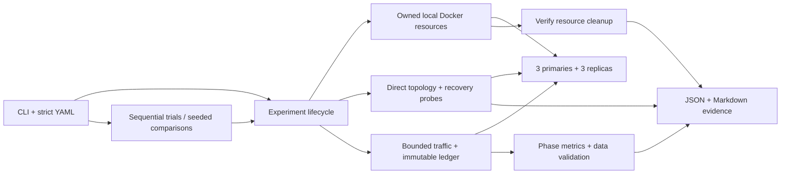

# Redis Reliability Lab

A Redis cluster can serve requests again after a primary crash while still having reduced redundancy or missing acknowledged data. This Go CLI measures those conditions separately in reproducible local fault experiments.

It provisions **three primaries and three replicas**, drives bounded synthetic traffic, injects a managed fault, verifies every successful SET acknowledgement, and saves JSON and Markdown reports after checking cleanup. It supports primary and replica crashes, whole-node network isolation, optional former-primary repair, all-process restart, SET/WAIT/WAITAOF policies, sequential trials, and counterbalanced comparisons. The experiments expose asynchronous replication, failure detection and elections, cached routing, replication repair, and acknowledgement-versus-persistence trade-offs.

## Quick start

With Go 1.26+ and Docker running Linux containers through a local Unix socket, run from the repository root:

```sh
git clone https://github.com/Alaneel/redis-reliability-lab.git
cd redis-reliability-lab
make build
bin/redis-lab validate experiments/primary-failure.yaml
bin/redis-lab run -output reports experiments/primary-failure.yaml
```

Read `reports/<run-id>/report.md` first, then its JSON for configuration, raw observations, metrics, data validation, and cleanup. The default crashes the primary owning slot zero and leaves it stopped; service recovery therefore does not imply restored redundancy. [Detailed commands and configuration](docs/running-experiments.md).

**Real evidence:** the [Phase 3 original CLI regression](docs/examples/phase3/primary-failure-regression/report.md) recovered and checked **2,030 acknowledged values** with zero missing, corrupt, unreadable, or unverified records; **87 ambiguous SET outcomes** remained separate. Promotion was first sampled at **5.370 s** and joint topology/client stability at **8.567 s** after fault orchestration began. Cleanup succeeded. These are observations from one local run, not recovery or durability guarantees. [Raw JSON](docs/examples/phase3/primary-failure-regression/report.json) · [Validation record](docs/phase3-validation.md#final-original-cli-regression).

## What the experiments expose

| Distributed-systems concept | How the lab makes it observable |
|---|---|
| Failure detection and promotion | Direct node views record gossip failure flags, promoted ownership, and slot-map convergence separately from client recovery. |
| Client routing and availability | Cluster-aware traffic exercises cached routing and MOVED/ASK handling; all-shard probes and workload errors show client-visible recovery. |
| Asynchronous replication | Immutable acknowledged writes are read back after drain; error-returning SETs remain ambiguous rather than being called lost. |
| Replica resynchronization | Same-container restart/reconnect preserves identity; link health, assignments, and sustained six-node checks establish restored redundancy. |
| Acknowledgements and persistence | Connection-affine WAIT/WAITAOF and a frozen ledger separate policy satisfaction, service recovery, and observed value preservation. |

The [Phase 3 evidence](docs/phase3-validation.md) includes replica lifecycle and failure paths, three persistence modes, and two nine-trial comparisons. Its retained [complete integration log](docs/examples/phase3/full-integration.log) records **22 passing top-level Docker test groups** with race detection in **781.960 s** on macOS arm64. The [persistence comparison](docs/examples/phase3/persistence-comparison/comparison.md) includes a memory control that lost all 1,251 checked values; the [AOF policy comparison](docs/examples/phase3/policy-comparison/comparison.md) retains short acknowledgements and ambiguous outcomes. See the [release audit](docs/release-audit.md) for release checks and their platform scope.

## Architecture



The observer reads nodes directly, independently of the workload client's cached routing. Recovery requires sustained applicable topology and client checks, complete acknowledged-write validation, and successful cleanup. Requested repair, acknowledgement policy, and persistence add their own criteria. [Architecture](docs/architecture.md) · [Measurement methodology](docs/measurement-methodology.md).

## Key trade-offs

- **One local host:** fresh six-node clusters make trials reproducible and inexpensive, while shared CPU, network, Docker VM, and storage limit environmental independence.
- **Bounded load and evidence:** explicit worker, rate, write, and sample limits keep runs controlled; offered requests can be dropped when workers are occupied, so this is not a capacity benchmark.
- **Sampled recovery:** independent topology and client observations prevent a running process from being mistaken for recovery; polling and request durations limit timing resolution.
- **Explicit acknowledgement accounting:** SET success remains in validation even when subsequent WAIT/WAITAOF is short or fails; this costs more bookkeeping but preserves the measured population.
- **Managed faults and cleanup:** exact resource ownership checks constrain destructive actions; altered resources are preserved and reported rather than removed blindly.

The [architecture decisions](docs/README.md#architecture-decisions) explain these choices and their consequences.

## Limits

**This is a single-host process and network lab.** Whole-node isolation disconnects the entire bridge interface in both directions, including host-client access. It does not model selective links, one-way partitions, minority-side writes, independent machines, availability zones, or WAN delay.

All-process restart retains the host, Docker VM, storage, and page cache. AOF preservation and WAITAOF acknowledgements in these trials establish neither physical power-loss durability nor linearizability or universal loss-free failover. Authentication and TLS are outside this local lab's scope.

Traffic and probes cover one hash-tag location per original shard, not every slot. Seeds reproduce random choices, while scheduling, replication, and elections remain nondeterministic. Small trial counts and histogram estimates do not establish population tails or statistical significance; missing observations remain unobserved.

## Prerequisites and checks

- Go **1.26+**; `go.mod` selects toolchain **go1.26.9**, which Go may download.
- Docker Engine or Docker Desktop with **Linux containers**, the Docker CLI, and a **local Unix socket**; TCP/SSH endpoints and native Windows named pipes are rejected. Prefer **Docker Engine 28+ on native Linux**; older engines have a localhost-publication caveat described in the [Security policy](SECURITY.md).
- macOS or Linux, registry access on every run, and internet access for initial Go dependencies. Provisioning pulls the exact Redis version tag even when cached; digest pinning is also supported.
- Capacity for six containers, each capped at **256 MiB RAM and one CPU**, plus Docker and the Go process. Disposable data volumes have no hard filesystem quota.

```sh
make check        # formatting, vet, and fresh unit tests with race detection; no Docker required
make integration  # opt-in real Docker faults; race detection and a 20-minute suite deadline
```

Configuration validation requires no Docker. Test configuration and historical execution evidence are distinct; [validation records](docs/README.md#validation-and-raw-evidence) retain executed results.

## Cleanup

Normal completion, `Ctrl+C`, and `SIGTERM` attempt bounded cleanup and verify that the run's containers, network, and disposable volumes are gone. A hard kill, machine shutdown, or unavailable daemon can leave resources. Replace `RUN_ID` with the exact ID printed in logs or saved reports:

```sh
bin/redis-lab cleanup RUN_ID
```

Ownership, names, endpoints, and isolation settings are checked before managed actions. Cleanup is idempotent and preserves unrelated resources and downloaded images. Loopback publication is a configured boundary, whose behavior also depends on Docker and the host; the historical Docker 24.0.6 evidence used macOS Docker Desktop. [Cleanup details](docs/running-experiments.md#cleanup-and-interruption) · [Security policy](SECURITY.md).

## Read further

- [Portfolio walkthrough](PORTFOLIO.md): engineering problem, decisions, evidence, and limitations.
- [Documentation index](docs/README.md): experiments, concepts, validation, and architecture decisions.
- [Run and configure experiments](docs/running-experiments.md): all CLI commands, defaults, report interpretation, and expected partial outcomes.
- [Contributing](CONTRIBUTING.md): local development and checks.

This independent project uses synthetic data and contains no employer infrastructure, credentials, or production configuration. Project source is [MIT licensed](LICENSE); Redis, Docker, Go, and dependencies retain their respective licenses. See [third-party notices](THIRD_PARTY_NOTICES.md).
