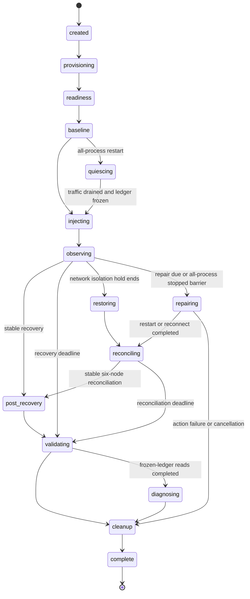

# Architecture

The lab implements a bounded lifecycle with independently testable packages. It supports primary/replica crashes and whole-node isolation, identity-preserving repair, sequential all-process crash/restart, three persistence modes, repeated and counterbalanced trials, and SET/WAIT/WAITAOF policies. [Replica lifecycle](replica-lifecycle.md), [durability semantics](durability-semantics.md) and the [validation record](phase3-validation.md) retain real lifecycle, persistence, WAITAOF and both nine-trial comparison results.

## Components and boundaries

| Component | Responsibility | Boundary |
|---|---|---|
| `cmd/redis-lab` | Commands, exit codes, signal cancellation, logging | User input and output |
| `internal/config` | Defaults, strict YAML decoding, bounds validation | Versioned experiment definition |
| `internal/environment` | Local Docker verification, provisioning, crash/restart/isolation/restoration, disposable data inventory, cleanup | Fixed Docker operations with explicit IDs |
| `internal/cluster` | Parse source Redis replies and evaluate readiness/recovery | Direct connection to every managed node |
| `internal/experiment` | Lifecycle, deadlines, fault selection, all-shard probes, outcome | `EnvironmentManager` interface and package APIs |
| `internal/workload` | Aggregate pacing, traffic, full SET ledger and WAIT/WAITAOF subset verification | `Client` and connection-affine `WriteExecutor` interfaces |
| `internal/metrics` | Concurrency-safe phase/window counts, bounded latency histograms | Completed client operations |
| `internal/report` | Evidence schema and atomic file writes | JSON plus readable Markdown |
| `internal/batch` | Sequential fresh trials, evidence validation, censor-aware summaries | Existing runner callback and saved individual reports |
| `internal/comparison` | Seeded rotating condition order and separate condition summaries | Verified single-trial batches |

Docker management uses the standard library's process API with fixed argument lists. It invokes the installed Docker CLI rather than adding an Engine SDK dependency. There is no shell interpolation, arbitrary command hook, external service, or general plugin framework.

Batch execution reuses the complete runner without duplicating provisioning or cleanup. Each callback returns only after cleanup and reporting. The batch checks unique run IDs, exact effective configuration, matching saved JSON, nonempty Markdown, and cleanup evidence before accepting a trial. An uncertain cleanup stops new trials; ordinary measured non-recovery remains visible and permits another fresh trial. Summaries are refreshed after each finished trial so an interrupted batch retains completed evidence. [ADR 0005](decisions/0005-sequential-trials-and-explicit-censoring.md) and [measurement methodology](measurement-methodology.md) define outcome populations and conditional statistics.

Comparison execution generates a seeded permutation and rotates its positions by one each round. A complete block of as many rounds as conditions balances round positions; an incomplete block is only partly balanced. Every entry creates a fresh verified batch trial, preserving the full schedule, configuration hash, host/image references, outcome and report paths. Per-condition summaries retain measured partial/failure results and explicit unstarted counts. Cancellation, missing saved evidence, unsafe cleanup or summary-write failure stops further provisioning. Ordering reduces position confounding without proving independent samples, causality or significance; request percentiles remain per trial.

The saved [nine-trial persistence comparison](examples/phase3/persistence-comparison/comparison.md) exercised this schedule with three trials per mode. All nine individual evidence/cleanup checks passed; the three memory controls remained partial with measured loss and the six AOF trials recovered. No failed or partial trial was filtered from the condition populations.

The matched [nine-trial policy comparison](examples/phase3/policy-comparison/comparison.md) used AOF-always and primary crash/repair for SET, WAIT and WAITAOF. Every trial recovered and verified cleanup. Its 13,980 checked SET acknowledgements included 668 short-WAIT and 730 short-WAITAOF writes; 359 ambiguous SET outcomes stayed outside the ledger. All policies used six quiet runtime observations and three selected-policy probes before baseline. The earlier persistence cohort predates that common policy warmup; its original evidence remains unchanged. Neither cohort pools latency quantiles or establishes significance from three trials per condition.

## Lifecycle and state

Any active stage can transition to cleanup on error or cancellation. The lifecycle rejects illegal transitions and regressing timestamps. Lifecycle completion means the run finalized; the report's outcome independently states whether the experiment recovered, partly recovered, failed, or was aborted.

Provisioning and readiness have independent deadlines. Traffic starts only after six-node readiness; the baseline must meet the configured success fraction before injection. The primary owning the lowest initial slot and its replica are selected from an observed healthy snapshot, making the target shard independent of randomized Redis IDs. Replica experiments fault the selected replica while retaining the original primary/slot context. Readiness and selection are repeated immediately before injection.

For individual-node faults, a recovery deadline bounds observation. A negative sample resets the stability interval. Stable topology and client probes must overlap for `stable_for`, then the runner continues observing during `post_recovery`. A sample that crosses the recovery deadline remains in raw evidence with `excluded_from_recovery: true`; it cannot update accepted recovery or milestones. Traffic remains active through observation; it stops and drains before data validation.

Primary isolation observation continues through the configured hold even after majority service recovers. Restoration reconnects the same container to its original IP and published loopback port, then resets stability tracking. Reconciliation requires all six original Redis identities and endpoints, the promoted replica retaining ownership, former-primary demotion and synchronized replication. Fixed administrative Redis probes establish process survival independently of client or cluster health. Cancellation and ambiguous disconnect errors still trigger fresh bounded restoration before cleanup. [Fault semantics](network-partition.md)

Replica service observations require all three original leaders and owners, five healthy unaffected nodes, and unaffected replica links; failed-target gossip can be absent or stale without inventing a service outage. Replica crash/isolation holds end in repair even when ordinary service remained available. Optional primary crash repair begins only after failover service was observed stable. It starts the same stopped container with retained membership and independently verifies its original Redis Cluster ID, original endpoints, and changed process start time. No forced `CLUSTER REPLICATE` or slot mutation is issued.

The repair budget covers both the physical action and synchronization. Completion starts a fresh stability interval. Replica restoration requires all six original identities, endpoints, owner maps, and replica assignments. Former-primary restoration preserves promoted ownership and requires the old primary to rejoin as its synchronized replica. Initial synchronization readiness and all-shard client probes must overlap for `stable_for`; post-recovery continues testing the current state. Historical service milestones cannot establish current final redundancy. Late repair samples remain evidence but are excluded from recovery decisions. [Lifecycle criteria](replica-lifecycle.md#service-and-redundancy-have-separate-criteria)

All-process restart follows a distinct path. Before baseline it observes six quiet, correctly configured processes and data files. Its end-baseline read-only topology snapshot precedes drain; the runner then drains traffic, freezes the full SET ledger, kills the original replicas followed by primaries, and verifies all six stopped before any restart. Same-container restart preserves volumes, identities and original owners. Read-only stable topology and fresh post-sync runtime evidence precede frozen-ledger GET validation. Only after validation completes can separate diagnostics issue fresh writes. No workload is offered during fault/restoration, so topology and diagnostic recovery latency are not workload availability measurements. [Frozen-ledger decision](decisions/0009-frozen-ledger-all-process-persistence.md)

## Provisioning and isolation

Each run gets a random 96-bit hexadecimal ID. Resource names and labels associate exactly one bridge and six containers with that ID. The bridge disables egress IP masquerading and client ports publish only to loopback. This retains host access on Docker versions where `--internal` bridges suppress published ports. It is a scoped local lab network, not a firewall against the Docker host or a host with explicit routes to its subnet. Every node has a stable local identity (`node-1` through `node-6`) and a separately observed Redis node ID. [Docker bridge configuration](https://docs.docker.com/engine/network/drivers/bridge/)

The provisioner permits only an exact official `redis:X.Y.Z-alpine` tag, optionally with an image digest. Each run explicitly pulls that image, requiring registry access even with a cached image. Exact tags may change, so use a digest suffix for stronger reproduction. The report records the resolved image ID and repository digests, daemon version, daemon operating system/kernel/architecture, Redis timeout, and container limits. Redis server version is obtained independently from `INFO server`.

Container settings are read-only root filesystems, UID/GID 999 execution, no bind mounts, no capabilities, no new privileges, 100-process limits, 256 MiB memory limits, and one-CPU limits. Ordinary crash/isolation runs use a 128 MiB `/data` tmpfs. Retained-identity and AOF runs use six tracked disposable local volumes. Memory disables scheduled RDB and AOF; `rdb-del-sync-files yes` allows Redis to remove replication RDB files after module-dependent diskless-load fallback. AOF everysec/always use the bundled modules' required hybrid RDB-format base, incremental AOF and manifest. Percentage-triggered automatic rewrite is disabled, while startup/full-sync rewrites remain observable. Finite traffic/probe budgets, payload/write caps and Redis `maxmemory 128mb` bound traffic; volumes have no hard filesystem quota.

Redis uses its internal port 6379; the cluster bus remains within the private bridge. Each client port publishes only to `127.0.0.1`. Isolation and retained-data runs use explicit private IPAM and fixed ephemeral host bindings so reconnect/container start can preserve the exact original endpoints. Other runs use Docker-assigned loopback ports. [Retained identity decision](decisions/0008-retained-identity-and-independent-redundancy.md)

The manager resolves the Docker endpoint once and accepts only a local Unix socket. Each subsequent invocation explicitly specifies that socket and clears ambient endpoint/context/TLS overrides. Operations use bounded contexts. A changed Docker context cannot redirect an active run to another daemon.

Redis nodes exchange their Docker network addresses. A cluster-aware Go client translates those exact addresses to their exact published loopback ports. This permits Docker Desktop use without relying on host routing to container IPs. Its dialer refuses unknown addresses, including unexpected redirection destinations. The cluster client handles routing and `MOVED`/`ASK`; metrics record errors remaining visible to the caller.

Client settings are explicit: RESP2, `ClusterStateReloadInterval=1s`, `MaxRedirects=8`, disabled per-node command retries (`MaxRetries=-1`), one attempt per pool dial (`DialerRetries=1`), and per-node pool size 16. Operation context deadlines and dial/read/write/pool timeouts are enabled. Direct observers also use RESP2 and one pool-dial attempt. These settings are recorded in the report. A dead primary cannot send `MOVED`; periodic lazy topology refresh bounds how long its cached ownership persists under traffic. [ADR 0004](decisions/0004-explicit-client-refresh.md) records the runtime finding behind this choice.

## Independent observation and recovery

The observer reads `CLUSTER INFO`, `CLUSTER NODES`, `INFO replication`, `INFO server`, `INFO persistence`, and `INFO stats` directly from each managed node. This separates observed cluster state from the workload client's cached routing state. Every source reply, parsed map, and command/parsing error remains in JSON. Optional derived replication indicators retain observed zero/false values and leave unknown fields absent. Concurrent observations make a snapshot a bounded collection of local views, rather than an atomic distributed snapshot.

Initial readiness requires six directly observed identities, three healthy primaries, one replica per primary, connected replication links with initial synchronization complete, unique healthy coverage of all 16,384 slots, and agreement on slot ownership and replication roles. Completion of synchronization establishes readiness; it does not guarantee later writes are replicated before acknowledgement. [CLUSTER INFO](https://redis.io/docs/latest/commands/cluster-info/), [CLUSTER NODES](https://redis.io/docs/latest/commands/cluster-nodes/)

Primary-failover service recovery requires the original target unreachable, five healthy surviving identities, the original replica promoted and owning every failed-primary slot, preserved unaffected slot ownership and replication relationships, complete usable coverage, converged surviving views, and successful client probes spanning the stability interval. The full-coverage milestone additionally verifies that every reported slot owner is directly reachable and excludes the known killed primary, even before gossip marks it failed. A restarted process alone would satisfy none of these predicates. Replica faults have their own original-owner service predicate, and requested repair adds the all-six predicates described above.

Independent results describe topology, ordinary client service, data verification, process restart and replication redundancy. A primary crash without repair leaves reduced redundancy; reconnect and requested repair can restore it. WAIT adds an independently sampled all-shard acknowledgement-policy stability condition. Basic service can recover while WAIT remains unavailable on a promoted shard without a replica. A recovered outcome needs all applicable current conditions, complete data validation, and verified cleanup.

Persistence recovery additionally requires the actual all-stopped barrier, identity-preserving restarts, fresh matching runtime/file evidence and preservation of the frozen ledger. All six running or `cluster_state:ok` cannot establish data recovery. Memory has no persistence mechanism at risk: its persistence observation is absent while the observed disabled configuration sets the independent persistence dimension false. Its healthy restored topology can coexist with complete measured loss and a partial outcome. Post-restart replication can copy one persisted shard dataset to a replica; preservation does not prove six independently durable AOF copies.

Schema 3 adds lifecycle and persistence fault receipts, frozen-ledger/action anchors, raw preparation/restoration evidence, synchronization milestones and independent sample/final dimensions for process, membership, slots, leaders, reads, writes, data, write policy, redundancy and persistence. Nil dimensions remain unobserved. Saved schema 1/2 evidence remains unchanged and readable. Promotion is not at risk for replica faults or unchanged-owner all-process restart. Restoration, frozen verification and diagnostics have separate observation horizons; unobserved events are not zero-duration recoveries. Physical restart remains distinct from stable redundancy and verified data.

Full/partial resynchronization inference compares primary `sync_full`, `sync_partial_ok`, and `sync_partial_err` counters only when direct identity, endpoints, process run ID, and replication ID remain comparable. For former-primary repair, the baseline is the promoted primary before repair, rather than the old primary before failure. Missing, invalid, or decreasing counters yield unknown evidence. Positive deltas remain server-wide synchronization-request observations; separate replica link and initial-sync checks establish sampled readiness, without an exact target transfer, event duration, byte-loss, or durability claim. [Redis INFO](https://redis.io/docs/latest/commands/info/)

## Workload and data contract

A central dispatcher accounts for elapsed ideal request periods and offers only the latest due request over an unbuffered channel. Missed periods, busy workers and unusable offers become explicit drops without catch-up bursts. After draining, offered equals started plus dropped, and started equals completed logical requests. The configured rate is a ceiling rather than achieved throughput. Worker-local seeded generators choose reads and writes; scheduling is not deterministic.

Distinct immutable keys embed the run ID, sequence, and a shard hash tag. Three tags map to the three contiguous initial shard ranges. Attempted writes cycle across these tags. Values derive deterministically from the recorded run ID, seed, and sequence. Successful `SET` returns append to a mutex-protected ledger; failed writes increment an ambiguous-outcome count because a response error does not prove the server did not execute the command.

Reads choose acknowledged ledger entries and compare exact values. A missing acknowledged key or mismatching value is a correctness violation during traffic. After draining workers, validation reads every acknowledged key, counting checked, missing, corrupt, and unreadable entries. Validation deadlines are explicit, and incomplete validation is not success. The write cap bounds both data generation and the in-process ledger.

All write policies use the same managed writer: topology selection through the cluster client, owned no-retry node pools and one sticky physical connection for SET and optional WAIT or WAITAOF. Only an explicit, exact-slot, allowlisted MOVED/ASK SET rejection permits bounded replay; transport failures and acknowledgement-command results do not. ASKING session state uses a disposable connection. A successful SET's timestamp is captured before the acknowledgement command. Every SET acknowledgement enters validation, including short, failed or unattempted commands; WAIT- and WAITAOF-satisfied subsets have separate verification counters. Diagnostic stages do not inflate logical requests. SET-stage attempts include routing/pre-send failures and do not prove wire execution; acknowledgement-attempt counters count client calls.

WAITAOF requests one local and one replica AOF fsync acknowledgement, validates exactly two nonnegative integer replies with local in `[0,1]`, and requires both thresholds for success. Paired reply histograms preserve known zeros; error replies are unknown. Local and replica satisfaction can overlap and must not be summed. All AOF policies share six-node quiet runtime preparation and a three-shard selected-policy compatibility probe before baseline. Issuing WAITAOF after freezing would fsync prior writes and bias the persistence test, so it is prohibited. WAIT concerns replication memory rather than disk, and both policies have recovery flags independent of ordinary service. [WAITAOF semantics](https://redis.io/docs/latest/commands/waitaof/)

This establishes observed readability and value equality. It does not establish linearizability, survival of another failure or durable storage. WAIT refers to earlier writes on the same connection and provides replica acknowledgements without a universal loss-free failover guarantee. [Consistency methodology](consistency-comparison.md), [WAIT semantics](https://redis.io/docs/latest/commands/wait/)

## Metrics methodology

- An attempt is one logical SET, SET+WAIT, SET+WAITAOF or GET completion. Policy success requires its requested counts; SET acknowledgement is accounted separately. Ordinary and policy probes are excluded from workload metrics.
- Successful, failed, and all-attempt latency distributions are separate. Duration starts just before the client call and includes connection/routing work performed within it.
- Histograms have 512 geometric buckets: the first upper bound is 1 microsecond and bounds grow by 5%, with a final overflow bucket. Quantiles select the nearest-rank bucket upper bound, capped by the observed maximum. Empty distributions have count zero.
- Success fraction is successful attempts divided by all completed attempts. Throughput is completed attempts divided by phase elapsed seconds. Operation counts are assigned to the phase when the request starts, including requests crossing boundaries.
- One-second windows use operation completion time, may span phase transitions, and expose availability changes hidden by a run-wide average. Window history is bounded to 3,600 entries, with dropped-window counts.
- Error classes distinguish timeouts, cancellation, connection failures, `CLUSTERDOWN`, terminal redirections, short WAIT/WAITAOF replies, loading/read-only conditions, missing values and mismatches. Short integer replies are distinct from client timeouts. Explicitly handled write redirects have separate policy counters.
- Fault time zero is the start of the validated fault-injection operation, including network/container ownership inspections before Docker `SIGKILL` or network disconnect; command completion and monotonic `fault_action_duration_ms` are recorded separately. Milestone runtime durations and stability checks retain monotonic clock readings, while JSON timestamps identify wall time. Markdown and batches also expose action-completion-relative times. Redis milestones are first sampled observations. Actual sample spacing includes direct observation, probes, and configured inter-sample delay. `topology_converged` records the first sample satisfying the applicable service topology predicate, including coverage, original/unaffected ownership, surviving-view agreement, and promotion for primary faults.
- The report retains at most 1,200 topology samples: the first 1,199 plus the latest. Dropped intermediate samples are counted, while milestones remain separately recorded.

Latency has histogram approximation error; recovery time has polling and request-duration uncertainty. A positive probe sequence demonstrates success at sampled times, while workload metrics quantify other client attempts. Report comparisons should include image digests, effective config hash, host resources, and repeat counts.

No-demand all-process fault/restoration phases have no workload availability denominator. Frozen validation and subsequent diagnostics remain separately timed, rather than showing synthetic zero-percent success or zero throughput. The real examples record a 12-logical-CPU host separately from the Docker VM's 13 CPUs, 8,232,312,832 bytes of memory and overlay2 storage driver; those are different runtime surfaces, not interchangeable resource counts.

## Failure handling and cleanup guarantees

Provisioning returns a partial resource inventory on failure. It also searches the exact run labels and expected names when Docker may have created resources before a command lost its output. Cleanup uses a fresh bounded background context, so cancelling the experiment does not immediately cancel resource removal.

Before a kill or removal, the manager verifies full resource IDs, both labels, expected names, read-only filesystems, lack of bind mounts, configured loopback publication, and membership in the run's bridge with egress masquerading disabled. Legacy managed internal bridges are also accepted for interrupted-provisioning cleanup. A partial container without an active published port or attached endpoint can be cleaned up when its configured network identity is exact; a fault target must have its live binding. An untracked kill target or modified resource causes refusal for that resource. Containers are removed by full ID; the network is removed only after confirming it has no attached containers. Unexpected attached containers are preserved and prevent network removal. Each removal is followed by an absence check. Missing already-removed resources make repeated cleanup safe. No daemon-wide prune is used.

Isolation-capable environments additionally use explicit private IPAM and exact loopback host ports, with persistent capability/original-endpoint labels. Detachment is accepted only for owned capable containers with zero attached networks; a foreign network or changed endpoint is refused. Manual discovery therefore supports interrupted isolation, and cleanup can remove a validated detached container directly. Reconnection refuses occupied original IPs, changed process identity or changed ports, and does not recreate resources. [ADR 0006](decisions/0006-full-node-network-isolation.md)

Retained-data inventory additionally validates exact run/node volume names and labels, local drivers, and the expected `/data` mount. Restart refuses a running target, changed Cluster ID, or contradictory endpoint/process evidence. Action errors remain errors even if a fresh probe observes an applied restart. Cleanup removes validated containers before tracked volumes, verifies volume absence, and preserves foreign or altered resources. Manual discovery can recover partial retained inventories; cancellation does not cancel the independent cleanup budget. [ADR 0008](decisions/0008-retained-identity-and-independent-redundancy.md)

If the process is hard-killed or the daemon is unavailable, automatic cleanup cannot be guaranteed. `cleanup <run-id>` reconstructs the labelled inventory and applies the same checks. Images remain cached and reports remain on disk. A resource that changes scope or whose inspection fails is preserved and reported as a cleanup failure.

Reports are written after cleanup so their cleanup fields reflect the actual result. Each JSON/Markdown file is written, flushed, closed, and atomically renamed from a temporary file in the same directory. The pair is not a cross-file transaction; an error writing either file is returned. Report generation failures are never converted into experimental success.

## Trade-offs and extension points

The manager interface permits deterministic orchestration tests; concrete Docker management remains a constrained implementation. The small client interface permits workload failure/cancellation tests. Topology conditions are pure functions over snapshots. Fixed bounds prevent metrics, samples, and validation data from growing without limit.

Additional fault types should introduce explicit configuration, managed-resource checks, and their own expected recovery predicates. They should retain the shared lifecycle, metrics, and reporting contract. A generic arbitrary-command fault API would weaken reproducibility and safety, so it is intentionally absent. See the [decisions](decisions/) for the major choices.
